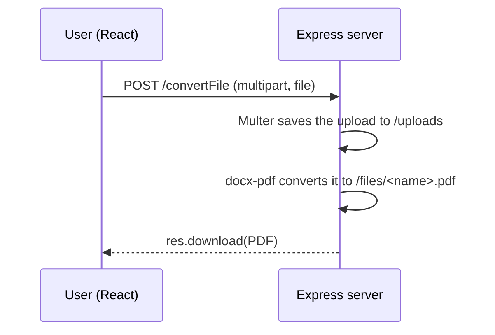

<div align="center">

# 📄 EasyConvert: Word to PDF in One Click

**Upload a `.doc` or `.docx` file and download it as a PDF instantly.**


### [🌐 Live demo](https://convertio-wsna.vercel.app/)

</div>

---

## ✨ Features

- **Pick a Word file** (`.doc` or `.docx` only)
- **One-click conversion** to PDF on the server
- The **PDF downloads automatically** when it's ready
- Clean, responsive UI built with Tailwind CSS and DaisyUI
- GitHub Actions workflow for Node.js CI

## 🧠 How it works



## 📡 API

| Method | Endpoint | Body | Response |
|:---:|---|---|---|
| `POST` | `/convertFile` | `multipart/form-data` with field `file` | The converted PDF as a download |

```bash
curl -X POST http://localhost:3000/convertFile -F "file=@resume.docx" -o resume.pdf
```

## 🚀 Run locally

```bash
git clone https://github.com/mayurvij22/EasyConvert-PDF-One-Click-Word-to-PDF-Solution.git
cd EasyConvert-PDF-One-Click-Word-to-PDF-Solution

# Backend
cd Backend && npm install && npm start

# Frontend (new terminal)
cd Frontend && npm install && npm run dev
```

## 🛠️ Tech stack

| Layer | Technology |
|---|---|
| Frontend | React, Vite, Tailwind CSS, DaisyUI, Axios |
| Backend | Node.js, Express, Multer, docx-pdf |
| CI | GitHub Actions |

---

<div align="center">

Made by **[Mayur Patil](https://github.com/mayurvij22)**

</div>
